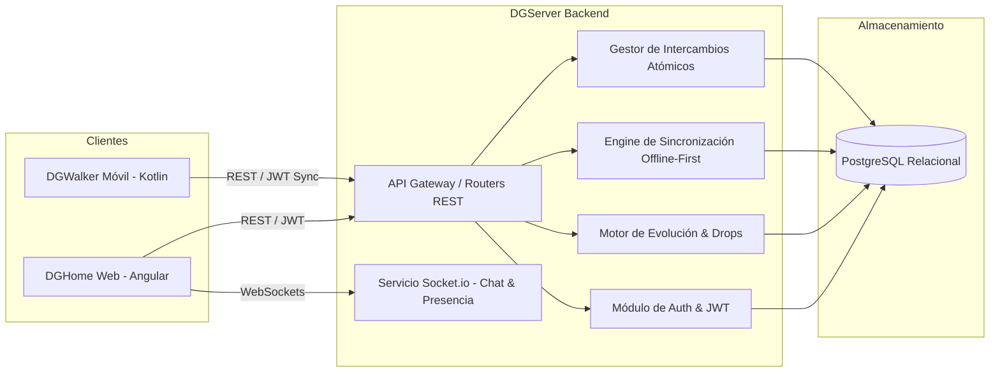

# DGServer 🛡️⚙️
### Servidor Backend Central: API REST, WebSockets & Motor de Juego

[](https://nodejs.org/)
[](https://www.typescriptlang.org/)
[](https://www.postgresql.org/)
[](https://socket.io/)
[]()

> Repositorio oficial del servidor backend común para el ecosistema **DGHome** (Web) y **DGWalker** (Móvil).  
> Proporciona los servicios de autenticación unificada, lógica de juego, motor de evoluciones ramificadas, inventario compartido, sincronización offline-first y mensajería en tiempo real.

---

## 1. Arquitectura y Responsabilidades



### Funciones Centrales:
1. **Autenticación Unificada:** Registro y login compartido con JSON Web Tokens (JWT) válidos tanto para la web como para la app Android.
2. **Motor de Evolución Ramificada:** Evaluación paramétrica de estadísticas (`HP`, `SP`, `ATK`, `DEF`, `INT`, `SPI`, `SPD`, `CRT Rate`, `Bond/Amistad`) para determinar desbloqueos de evolución no lineales.
3. **Control de Bloqueo de Estado (*State Lock*):** Cuando un Digimon es asignado al equipo de paseo en DGWalker, el servidor bloquea su disponibilidad para acciones simultáneas en DGHome hasta que el paseo finaliza o se sincroniza.
4. **Sincronización Offline-First:** Endpoint de ingesta masiva que recibe las sesiones de pasos, botín recogido y experiencia acumulada en local por DGWalker cuando el terminal recupera conexión.
5. **Transacciones Atómicas de Intercambio:** Control estricto de cupos de intercambio (3 al mes en web, 1 al día en NFC) mediante transacciones `BEGIN ... COMMIT` en PostgreSQL para prevenir duplicación de criaturas.
6. **Comunicación en Tiempo Real:** Salas de chat públicas para granjas y canales de mensajes privados directos entre amigos usando **Socket.io**.

---

## 2. Stack Tecnológico

- **Entorno de Ejecución:** Node.js 20+ LTS
- **Lenguaje:** TypeScript 5+
- **Framework Web:** Express.js (o NestJS)
- **Base de Datos Principal:** PostgreSQL 15+ (con soporte para transacciones ACID)
- **Persistencia / Migraciones:** TypeORM / Prisma / Knex con scripts SQL estándar
- **Comunicación en Tiempo Real:** Socket.io v4
- **Seguridad:**
  - `bcrypt` para hash seguro de contraseñas con sal.
  - `jsonwebtoken` (JWT) con tiempo de expiración y tokens de refresco.
  - `helmet` y `cors` para protección de cabeceras HTTP.

---

## 3. Modelo de Datos Central (PostgreSQL)

El esquema de base de datos utiliza tipos de datos estándar y columnas relacionales limpias (sin estructuras no indexables):

| Tabla | Descripción | Clave Primaria / Relaciones |
| :--- | :--- | :--- |
| **`users`** | Cuentas de usuario, credenciales cifradas y fecha de registro. | `id` (UUID / SERIAL) |
| **`user_profiles`** | Nombre de entrenador, biografía, nivel, avatar, banner y fecha de reinicio de cupos. | `user_id` FK $\rightarrow$ `users(id)` |
| **`species_catalog`** | Datos canónicos de cada especie (nombre, generación, atributo, tipo, sprite y descripción lore). | `species_id` (VARCHAR) |
| **`evolution_paths`** | Requisitos y umbrales numéricos de estadísticas para digievolucionar de una especie a otra. | `id`, `from_species`, `to_species` |
| **`user_digimons`** | Instancias de Digimons criados por cada usuario (mote, nivel, EXP, stats individuales, cansancio, hambre, `is_walking`). | `id` (UUID), `user_id` FK |
| **`items_catalog`** | Catálogo de objetos con efectos directos (hambre, amistad, stats, pasos de eclosión). | `item_id` (VARCHAR) |
| **`user_inventory`** | Cantidad de cada objeto en posesión del usuario (`quantity`). | `(user_id, item_id)` PK compuesta |
| **`friendships`** | Vínculos de amistad entre usuarios con estado (`PENDING`, `ACCEPTED`, `BLOCKED`). | `(user_sender_id, user_receiver_id)` |
| **`chat_messages`** | Historial de mensajes entre amigos o en salas de granja con timestamp. | `id`, `sender_id`, `receiver_id` |
| **`trades_web`** | Registros de intercambios en la plataforma web (ofertas de 1 a 3 slots). | `id`, `user_a_id`, `user_b_id` |
| **`walk_logs`** | Auditoría y registro de paseos sincronizados desde DGWalker. | `id`, `user_id`, `steps`, `synced_at` |

---

## 4. Catálogo de Endpoints REST Principales

### 🔐 Autenticación (`/api/v1/auth`)
- `POST /register`: Registro de nuevo usuario (valida username y formato de email).
- `POST /login`: Autenticación con credenciales; emite access token JWT y perfil básico.
- `POST /refresh-token`: Emisión de nuevo token de sesión sin cerrar sesión.
- `POST /forgot-password`: Envío de email con token de restablecimiento.

### 🦖 Digimons & Granja (`/api/v1/digimons`)
- `GET /mine`: Devuelve los Digimons pertenecientes al usuario conectado (con filtros por tipo, atributo y generación).
- `GET /:id`: Ficha detallada de una criatura individual con desglose de PV, PH, EXP, amistad y stats.
- `PATCH /:id`: Actualización de mote, skin estética o estado de la criatura.
- `POST /:id/feed`: Alimenta al Digimon con un objeto `COMIDA` del inventario (reduce hambre, suma amistad).
- `POST /:id/evolve`: Comprueba si cumple los umbrales numéricos y ejecuta la digievolución ramificada.

### 🎒 Inventario y Tienda (`/api/v1/inventory` y `/api/v1/shop`)
- `GET /mine`: Listado de objetos del usuario clasificados por pestañas (`COMIDA`, `CHIPS`, `COSMETICOS`, `MUEBLES`).
- `POST /use-item`: Consume un objeto sobre un Digimon o granja.
- `GET /packages`: Catálogo de paquetes de inicio y recursos de la tienda.
- `POST /buy-package`: Compra de artículos con moneda del juego o gemas premium.

### 🌐 Sincronización Móvil Offline-First (`/api/v1/sync`)
- `POST /upload-walk`: Ingesta masiva desde DGWalker tras un paseo offline:
  ```json
  {
    "sessionId": "walk-uuid-1234",
    "stepsCount": 4500,
    "teamDigimonIds": ["digi-1", "digi-2", "digi-3"],
    "expGainedPerDigimon": 350,
    "friendshipGained": 25,
    "foundLoot": [
      { "itemId": "carne_comun", "quantity": 2 },
      { "itemId": "huevo_basico", "quantity": 1 }
    ]
  }
  ```
- Devuelve confirmación de guardado atómico y libera el estado de paseo de los Digimons.

### 🤝 Intercambios y Social (`/api/v1/trades` y `/api/v1/social`)
- `POST /web/propose`: Inicia una oferta de intercambio web (límite 3/mes).
- `POST /web/:tradeId/confirm`: Acepta la propuesta y efectúa la transferencia de titularidad.
- `POST /nfc/validate`: Valida el token temporal emitido por el sensor NFC y descuenta el cupo de 1/día.
- `GET /friends`: Lista de amigos con indicador de presencia y último mensaje.
- `POST /friends/request`: Envía solicitud de amistad por UID o nombre de usuario.

---

## 5. Eventos de WebSockets (Socket.io)

El servidor expone un gateway de WebSockets en el mismo puerto:

| Evento de Entrada | Payload | Evento Emitido | Descripción |
| :--- | :--- | :--- | :--- |
| `join_farm_room` | `{ farmOwnerId }` | `user_joined_farm` | Ingreso a la sala visual de la granja de otro usuario. |
| `send_farm_chat` | `{ farmId, text }` | `new_farm_message` | Mensaje público visible en el chat de la granja. |
| `send_private_msg` | `{ targetUid, text }`| `receive_private_msg` | Mensaje privado directo entre amigos. |
| `trade_state_change` | `{ tradeId, payload }`| `trade_updated` | Actualización de las casillas de intercambio en tiempo real. |

---

## 6. Variables de Entorno (`.env.example`)

Crea un archivo `.env` en la raíz del proyecto backend con los siguientes parámetros:

```env
# Servidor
NODE_ENV=development
PORT=3000
API_PREFIX=/api/v1

# Base de Datos PostgreSQL
DB_HOST=localhost
DB_PORT=5432
DB_USER=postgres
DB_PASSWORD=postgres
DB_NAME=dg_database
DB_SSL=false

# Seguridad y Autenticación
JWT_SECRET=super_secreto_para_firmar_tokens_jwt_123456
JWT_EXPIRATION=7d
REFRESH_TOKEN_SECRET=secreto_para_refresh_tokens_789012
REFRESH_TOKEN_EXPIRATION=30d

# Configuración de Red & CORS
CORS_ORIGIN=http://localhost:4200,http://localhost:8100
```

---

## 7. Instalación y Puesta en Marcha

### Con Base de Datos Local:
```bash
# 1. Instalar dependencias
npm install

# 2. Ejecutar migraciones y seeds iniciales
npm run db:migrate
npm run db:seed

# 3. Iniciar en modo desarrollo con recarga en caliente
npm run dev
```

### Con Docker Compose:
Si dispones de Docker, puedes levantar la base de datos PostgreSQL con un solo comando:
```bash
docker compose up -d postgres
npm run db:migrate
npm run dev
```

---

## 8. Scripts Disponibles en `package.json`

- `npm run dev`: Inicia el servidor con `ts-node-dev` o `nodemon` para desarrollo continuo.
- `npm run build`: Compila el proyecto TypeScript a JavaScript optimizado en la carpeta `dist/`.
- `npm start`: Ejecuta la versión compilada en `dist/index.js` (para entornos de producción).
- `npm run db:migrate`: Aplica las migraciones de esquema en PostgreSQL.
- `npm run db:seed`: Rellena el catálogo inicial de especies Digimon y tabla de objetos.
- `npm test`: Ejecuta la suite de pruebas unitarias y de integración con Jest.

